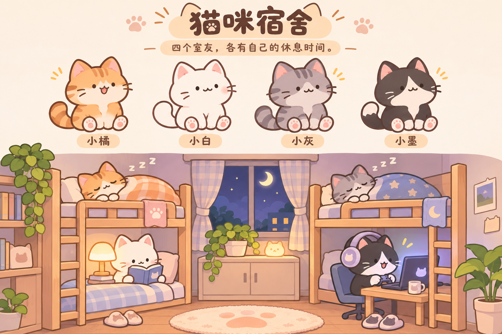
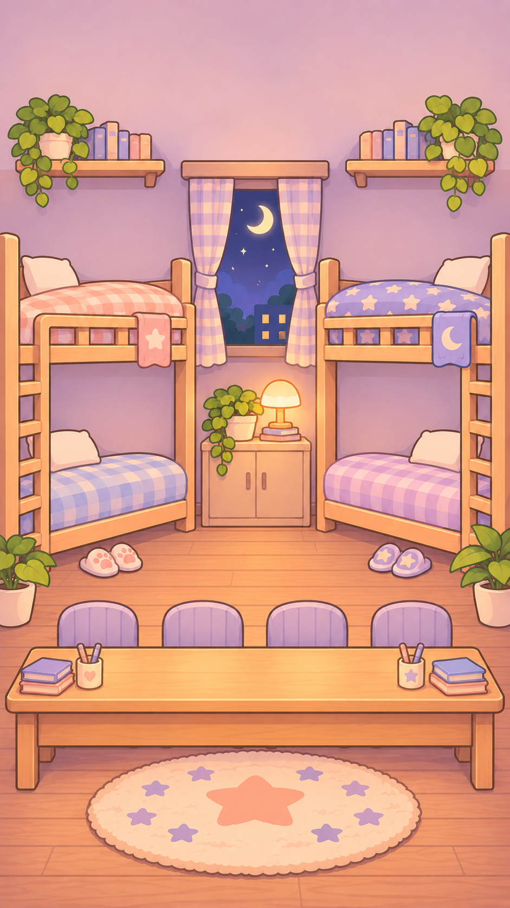

<div align="center">

# 🐾 宿舍小屋 · Dorm Cottage

**四只小猫，一个小小的家。让每一份休息，都被温柔看见。**

Android · 宿舍状态共享 · 今日纸条 · CloudBase · MIT



</div>

> 上图为早期设计概念图，用于展示美术风格；下方提供当前房间与角色素材预览，均非手机运行截图。

## 为什么做这个小屋

室友已经睡了，自己还想学习或打游戏；明早要早起做志愿，又担心洗漱、出门的声音打扰大家。很多小事不需要严肃地提醒，只需要提前轻轻说一声。

宿舍小屋把四位室友变成四只可爱的小猫：选好床位、取个名字，用状态告诉大家“我在做什么”，用纸条说说明天的安排。有人休息时，给还醒着的室友一条轻提醒，让彼此的作息更容易被看见。

## 可以做什么

| 功能 | 在小屋里怎么用 |
| --- | --- |
| 🏠 创建与邀请 | 自定义宿舍名，分享六位云端邀请码，最多四位室友入住 |
| 🐱 小猫与床位 | 首次选床位、八种猫咪形象、自定义名字，入住后也能换形象 |
| 🎮 日常状态 | 醒着、学习、听歌、读书、打游戏、暂时离开；学习娱乐时到公共桌前 |
| 💤 安静休息 | 现在休息或预约开始时间，附上“太累了”“身体不舒服”等原因，醒来后手动结束 |
| 💌 今日公告板 | 给全体或指定室友贴纸条，点开详情，删除自己的留言；北京时间零点后隐藏昨天的纸条 |
| 🛏️ 装扮小床 | 床单颜色与纯色、格纹、条纹、星星、猫爪等样式；睡觉时盖的被子使用同一设置 |
| ☀️ 房间氛围 | 北京时间白天太阳、夜晚月亮，全员休息时关窗帘；可轻戳猫脸互动 |
| 📳 轻提醒 | 只提醒醒着的人，同一事件去重，支持通知与短振动，实际受手机设置和后台策略影响 |

## 看看小屋

<table>
<tr><td align="center" width="42%"><strong>房间场景素材</strong><br></td><td align="center"><strong>猫咪活动素材</strong><br><br>学习 · 听歌 · 读书 · 打游戏<br><br>角色、名字、状态和被子由界面动态叠加。<br>这里展示的是美术素材，不是完整运行截图。</td></tr>
</table>

## 怎么开始

当前为 **0.3.0 安卓测试版**，支持 Android 8.0 及以上。云端版不用电脑开机，也不要求手机连接同一 Wi-Fi。

1. 下载仓库中的 [开源源码包](dorm-cottage-open-source.zip)，解压后进入 `dorm-cottage` 目录。当前完整代码位于 ZIP 内。
2. 创建你自己的 CloudBase PostgreSQL 环境，执行 `cloudbase/schema.sql`。
3. 将 `android-native/assets/cloud-config.example.json` 复制为 `cloud-config.json`，填写自己的 HTTPS RPC 地址与 anon Publishable Key。
4. 按下方构建说明生成 APK，安装后创建宿舍，邀请舍友选空床位入住。

**公开仓库不提供公共服务器或含作者线上配置的安装包。** 不同宿舍可在自行部署的服务里创建各自房间。云端宿舍不能使用旧热点版本的“六位码@IP:18765”邀请码。

## 提醒与免费额度

界面每 15 秒检查状态，后台每 60 秒检查新休息事件和纸条。只有醒着的人收到通知；同一事件不重复提醒。通知通道无声音，振动约 70ms，实际以手机通知设置为准。请允许通知、后台运行并避免强制停止应用。当前是后台轮询通知，尚未接入厂商远程推送。Android 15 等系统会限制 dataSync 前台服务的累计运行时间，达到上限会暂停后台同步并提示重新打开；省电策略、断网也可能延迟或中断提醒。

使用者需自行创建 CloudBase PostgreSQL 环境。免费额度、续期方式和功能以腾讯云控制台当前规则为准。仓库不提供公共宿舍服务，也不包含作者的线上连接配置。

## 代码位置

- `preview/index.html`：安卓 WebView 使用的界面、交互及分层被子渲染。
- `app/assets/`：房间、猫和状态插画素材。`room-neutral.png` 已清理固定床单花纹，`sleep-bare.png` 为被子下的猫身体素材；最终睡眠状态仍会显示动态被子。
- `android-native/`：实际打包的 Java 安卓项目；原生启动入口、HTTPS 客户端、后台服务、通知及振动。
- `cloudbase/schema.sql`：云端原子接口，私有 schema 保存房间，只有经过成员身份校验的函数公开调用；数据库管理员密码不会进入 APK。
- `cloudbase/test.mjs`：真实 PostgreSQL 引擎 PGlite 测试，运行 `cd cloudbase && npm install && npm test`。
- `server/`：本机 Python 网页预览与旧 LAN 逻辑，运行 `python3 -m unittest discover -s server -v`。
- `app/lib/main.dart`：早期 Flutter 原型，当前 APK 不使用该文件。

将 `android-native/assets/cloud-config.example.json` 复制为 `cloud-config.json`，填入自己的 HTTPS RPC 地址和官方 anon Publishable Key；后者不是管理员 API Key。真实配置已加入 `.gitignore`。成员身份 token 不写入源码，快照不返回其他成员 token。请勿将云服务管理员 API Key、个人数据库、用户纸条、签名 keystore 上传仓库。

## 构建 APK

需要 JDK 17、Android SDK Platform 35 和 Build Tools 35.0.1。设置 `JAVA_HOME`、`ANDROID_SDK_ROOT` 后运行：

```sh
DORM_BUILD_DIR=/absolute/path/to/build DORM_APK_OUT=/absolute/path/to/dorm-cottage.apk sh android-native/build.sh
```

脚本生成标准单一签名 APK，支持直接安装。首次构建会在构建目录创建测试签名密钥；后续使用同一个目录以保留签名。现有手机升级必须使用原密钥。请保留自己的签名密钥用于后续覆盖升级，不要提交到 GitHub。CI 默认新建测试密钥，其产物不保证可覆盖本机签名的旧版。

## 验证状态

云端 HTTPS 实测通过：创建与两个身份加入、并发抢床位只有一个成功、状态和床单同步、休息事件去重、自己删除纸条、拒绝删除他人纸条、退出后身份失效。PGlite 验证私有表无法由 anon 直接读取。安卓 APK 编译、包版本与签名校验通过；校园网/移动流量之间的双手机安装验收仍需实机完成。床单视觉层已改造，最新效果仍需手机截图验收。

## 开源与贡献

代码使用 MIT 许可证，详情见 LICENSE。插画为 AI 生成素材，随本项目提供，不保证在所有地区具有相同的版权保护范围。欢迎通过 Issues 反馈问题，提交复现步骤、手机系统版本和去除个人信息的截图；也欢迎提交 Pull Request。

第一次接入请先运行 `cloudbase/schema.sql`，然后配置自己的 `cloud-config.json` 并构建。未提供该文件时会使用本地局域网原型；云端版本需完成上述配置。首次构建生成的签名只用于测试。请勿发布你或舍友的身份 token、纸条内容、私钥或数据库管理员凭据。
